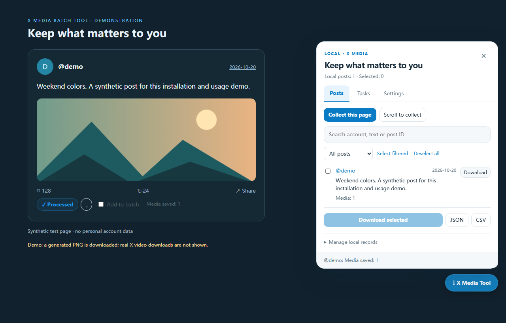

# X Media Batch Tool — X/Twitter Image & Video Downloader

[简体中文](README.zh-CN.md) · **English**

**X Media Batch Tool** is an open-source X/Twitter image and video downloader with per-post buttons and batch download queues. Save original-size images and highest-available MP4 videos, retry failed files, skip duplicates, and export post text and links. Available as a **Chrome Manifest V3 extension** and a **Tampermonkey userscript**, with **English and Simplified Chinese interfaces**.

**Latest release: v1.3.0** · [Downloads](https://github.com/AmBiTTion/x-media-batch-tool/releases/latest) · [Install userscript](https://github.com/AmBiTTion/x-media-batch-tool/raw/refs/heads/main/userscript/x-batch-tool.user.js) · [Installation guide](docs/INSTALL.en.md) · [FAQ](docs/FAQ.en.md)


## At a glance

| Question | Answer for v1.3.0 |
| --- | --- |
| What is it for? | Download individual posts or batch-save media from posts loaded on X/Twitter. |
| Who is it for? | Desktop users who want local media copies and post-text/link exports. |
| Installation | Load the Chrome extension folder or install the Tampermonkey userscript. No server or API key required. |
| Languages | English / 简体中文; follows browser language initially, with a saved manual override. |
| Media quality | X's `orig` image size and highest-bitrate downloadable MP4 found in loaded responses. |
| Data handling | Local browser records; no telemetry or third-party parsing service. |
| Limitations | No full-account archive; actual Android compatibility and real-account media downloads remain unverified. |

[Watch the English installation and usage walkthrough](https://github.com/AmBiTTion/x-media-batch-tool/releases/download/v1.3.0/x-media-batch-tool-en-v1.3.0.webm). Installation is explained on slides, followed by real controls on a synthetic page and a verified generated-PNG download. It is not a real X-account video download demonstration.

## Features

- A download button under each post, with actions for all media, images only, videos only, post text/link, and forced re-download.
- Original-size images (`name=orig`) and the highest-bitrate downloadable MP4 found in responses already loaded by the page.
- Per-post selection, collection of loaded posts, bounded scrolling collection, search, media/selection filters, and JSON/CSV export.
- A sequential task queue with progress, one automatic retry per failed file, duplicate skipping, manual retry, and stop controls.
- TXT sidecars, filename presets, configurable file intervals, light/dark themes, and a responsive collapsible panel.
- Local persistence of posts, settings, history, and tasks. Unfinished tasks become interrupted after reload and require manual retry.
- English / Simplified Chinese language switching without interrupting the active queue, plus a dismissible first-use guide.

## Install in desktop Chrome

1. Download `x-media-batch-tool-chrome-v1.3.0.zip` from [Releases](https://github.com/AmBiTTion/x-media-batch-tool/releases/latest) and extract it, or clone/download this repository.
2. Open `chrome://extensions/` and enable **Developer mode**.
3. Click **Load unpacked** and select the **`extension` folder containing `manifest.json`**.
4. Refresh your X tab. A download row appears under loaded posts; the bottom-right launcher opens the batch panel.

Minimum declared Chrome version: 111. This is an unpacked developer installation, not a Chrome Web Store listing. Use the extension and userscript **one at a time** to avoid conflicting versions.

### Update

Replace files in the existing installation folder, click the extension's **Reload** button at `chrome://extensions/`, then refresh X. Keep the installation path unchanged to retain that extension's local data. If you switch installation paths or formats, export records before changing; automatic migration between extension and userscript storage is not provided.

## Install with Tampermonkey

Install [Tampermonkey](https://www.tampermonkey.net/), then open the [raw userscript](https://github.com/AmBiTTion/x-media-batch-tool/raw/refs/heads/main/userscript/x-batch-tool.user.js). If the installer does not open, create a new script, replace its contents with `userscript/x-batch-tool.user.js`, save, and refresh X.

Allow userscripts/site access in your browser and download access in Tampermonkey when prompted. Mobile compatibility depends on the **exact Android browser and userscript manager**. A narrow-screen UI has been tested in desktop Chromium; actual Android injection, media capture, `GM_download`, permissions, and background behavior **have not been verified**. This release does not claim universal Android Chrome support.

## Use

For English, open **Settings → Interface language → English**. Chinese users can choose **设置 → 界面语言 → 简体中文**. **Follow browser** uses the browser's preferred language; other languages fall back to English. Your choice persists after refresh. It does not change X's own language.

| English / Chinese control | Action |
| --- | --- |
| Download / 下载 | Queue this post's media directly |
| ⌄ | Images/video/text actions, forced download, task list |
| Add to batch / 加入批量 | Select this post for batch operations |
| Posts / 帖子列表 | Collect, search, filter, select, download, export |
| Tasks / 下载任务 | Inspect progress/errors, retry unfinished tasks, stop queue |
| Settings / 设置 | Language, filename, text sidecar, deduplication, theme, advanced settings |

Filtering does not deselect posts outside the current filter. “Download selected” and exports act on **all selected posts**. Scrolling collects at most 100 rounds by default (configurable 1–300) and stops after eight rounds without new posts. The list renders up to 300 matching posts; batch operations still apply to all selected records. The task panel displays the latest 100 tasks; persistence retains the latest 100 ended tasks plus waiting/running tasks.

Stopping cancels waiting tasks and waits for the current file to finish or time out. “Retry unfinished” includes failed, cancelled, and interrupted tasks. Completed media are skipped by default; use a post's forced-download action to download them again. Removing local post records does not delete X posts or files on disk. Clearing ended tasks does not clear download history.

Files go to the browser's configured download location. “Ask where to save each file” and multiple-download permission are browser settings. In the userscript, TXT/export downloads are reported as **save initiated**, not verified file completion; the Chrome extension uses the browser completion event for its queued media/TXT downloads.



## Media boundaries and troubleshooting

- “Original image” means the size X serves as `orig`, not a camera RAW or guaranteed unmodified upload. “Highest quality video” means the highest-bitrate available MP4 returned by X, not the creator's pre-transcode source. GIF-style media commonly save as MP4.
- Refresh X after installation/update so response capture starts with the page. If video metadata is unresolved, open the original post, refresh, wait for media loading, then collect/download again. No third-party parsing service or hard-coded authenticated API is used.
- HLS-only streams, live broadcasts, unavailable/restricted/deleted media, and X changes may prevent downloading. An unresolved video is reported as an error; its cover is not treated as a video.
- Collection covers what the page actually loads. Collapsed long text, quotes, mixed media, and DOM changes can yield incomplete data. Verify important records against the original post.
- A timeout can be reported while Chrome later continues a download. Check Chrome's Downloads page before retrying. History cannot detect files you subsequently delete on disk.
- **Full-account archiving, profile-data export, and dedicated original/reply/repost/quote filters are not implemented in v1.3.0.**

## Common questions

**Can I batch-download Twitter videos and images?** Yes: collect loaded posts, select them, and queue matching media. This covers loaded, accessible content rather than every historical post on an account.

**Is it a Chrome extension or a userscript?** Both formats are included. Use one at a time; installation instructions are in the [English guide](docs/INSTALL.en.md).

**Does it work on Android Chrome?** Exact Android browser and userscript-manager versions must be tested. Responsive screenshots do not establish mobile injection or download compatibility.

**Is there a third-party download website or server?** No. Metadata is read from responses already requested by X; files are saved from X media hosts. See [privacy and permissions](#privacy-and-permissions).

More answers: [quality, duplicates, video failures and storage FAQ](docs/FAQ.en.md).

## Privacy and permissions

The extension declares `storage` and `downloads`; its content scripts run only on `https://x.com/*` and `https://twitter.com/*`. Media downloads are restricted to `pbs.twimg.com` and `video.twimg.com`. TXT files are generated locally.

The tool inspects page responses already requested by X, without storing login tokens. There is no analytics, upload service, or third-party parsing backend. Stored post text and media URLs may be private: use a trusted browser profile and clear/export records as needed. It does not automatically like, repost, follow, publish, or delete X content. Save only content you are authorized to access and use.

## Develop and test

Requires Node.js 18+ and npm.

```sh
npm ci
npm run build
npm test
npx playwright install chromium
npm run test:browser
```

Canonical userscript: `userscript/x-batch-tool.user.js`. `scripts/build.cjs` derives `extension/content.js`, `capture.js`, and `manifest.json`; the service worker source is `src/extension-background.js`. Generated installable extension files are committed for convenience. Rebuild before releasing changes.

Tests cover image URL conversion, MP4 bitrate selection, CSV escaping/formula protection, download-origin validation, strict Trusted Types UI boot, the extension capture bridge, actual JSON-file export, persistent settings, per-post controls, recycled post cards, narrow layout, duplicate/forced-download behavior, and partial-failure retry. Language tests cover browser detection, saved overrides, live switching during downloads, onboarding, and retained selection/tasks. Browser fixtures and queue callbacks are synthetic; the walkthrough separately verifies a generated PNG saved by the browser. **Real media downloads on a logged-in X account and real Android devices have not been verified.** Test profiles and generated artifacts are ignored by Git.

Translations are maintained in `src/i18n/en.json` and embedded into the standalone userscript by the build. Chrome extension name/description locales are also generated. To regenerate bilingual installation slides, screenshots and walkthroughs, run `node scripts/create-demo.cjs` after installing Playwright's Chromium. Videos are written to ignored `dist/demo/` for Release upload.

## Related projects and license

Initial research included [Media Harvest](https://github.com/EltonChou/TwitterMediaHarvest), [X Media Downloader](https://github.com/Rove24/X-Media-Downloader), and [Twitter Media Assist](https://github.com/Flkalas/TwitterMediaAssist). This implementation was written independently; these projects are references, not bundled dependencies.

[MIT License](LICENSE).
