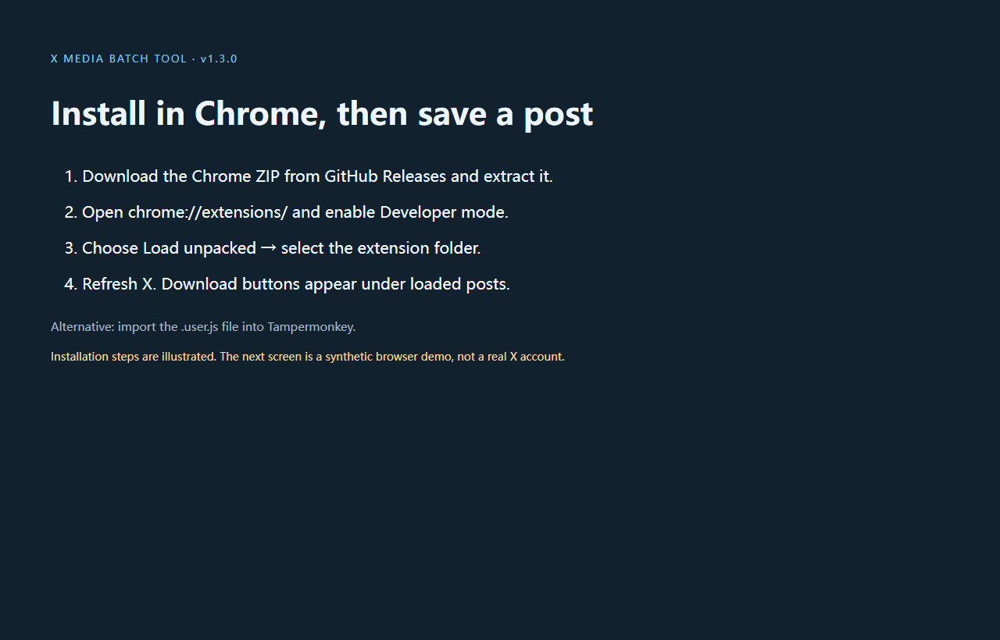
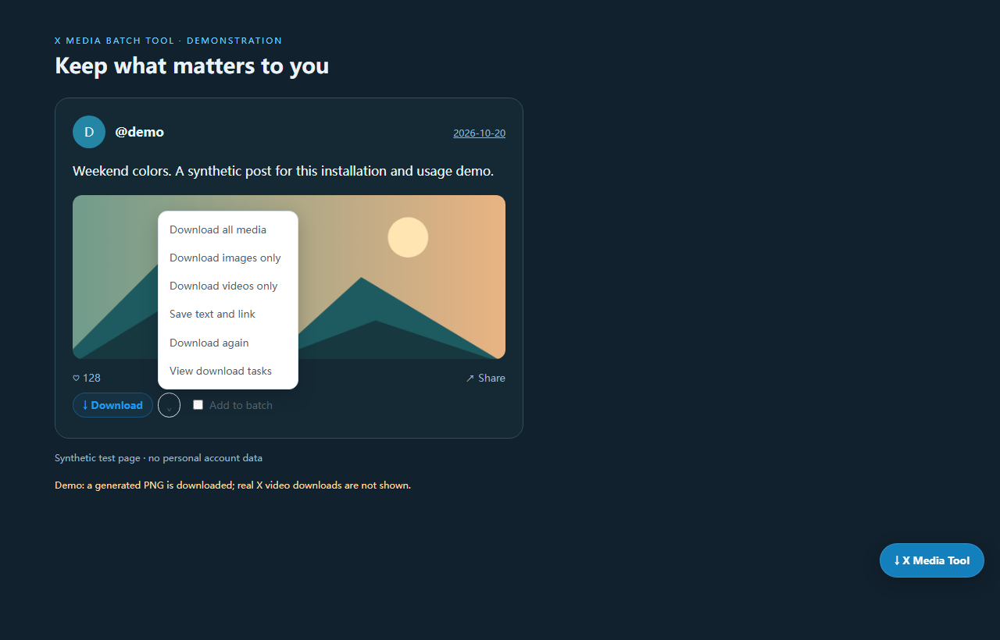

# Install X Media Batch Tool in Chrome or Tampermonkey

[简体中文](INSTALL.zh-CN.md) · [Project overview](../README.md) · [Troubleshooting](FAQ.en.md)

Applies to **v1.3.0**, a local X/Twitter image and video downloader. The Chrome package and userscript offer the same core tools; enable one format at a time.

## Chrome extension: four steps

1. Open [GitHub Releases](https://github.com/AmBiTTion/x-media-batch-tool/releases/latest), download `x-media-batch-tool-chrome-v1.3.0.zip`, and extract it to a permanent folder. GitHub's source ZIP also contains the installable extension.
2. Open `chrome://extensions/` in desktop Chrome and enable **Developer mode**.
3. Choose **Load unpacked**, then the **`extension` folder with `manifest.json` inside**. Do not select the ZIP or the parent project folder. Chrome declares the tool as **X Media Batch Tool — X/Twitter Image & Video Downloader** in English.
4. Refresh your X page. A **↓ Download** button and **Add to batch** checkbox appear under each loaded post; **↓ X Media Tool** at the bottom right opens the panel.

No Chrome Web Store submission is part of this release. Desktop Chrome 111+ is declared in the manifest. For actual Android compatibility, verify the exact browser and script manager first.

## Tampermonkey userscript

1. Install [Tampermonkey](https://www.tampermonkey.net/) in a browser that supports it.
2. Open the [raw `.user.js` file](https://github.com/AmBiTTion/x-media-batch-tool/raw/refs/heads/main/userscript/x-batch-tool.user.js), or import the Release asset. If needed, create a new script and paste the entire file, replacing the default template.
3. Save and enable the script, allow X site access/user scripts and download permission when required, then refresh X.

## First download

1. Use a post you are authorized to save. Click **Download** or choose **More save options → Download images only / Download videos only**.
2. Click the status next to the post to open **Tasks**. Inspect completion or the reason a file needs retry.
3. Look in the browser's download folder. To save a duplicate deliberately, use **Download again**. To include text automatically, enable **Settings → Save text alongside media**.
4. For batch use, select **Add to batch** on posts, or **Posts → Collect this page**, then **Download selected**. Scrolling collection is bounded and includes only loaded content.

## Language and updates

**Settings → Interface language** offers **Follow browser**, **简体中文**, and **English**. The Chinese route is **设置 → 界面语言**. Switching updates controls immediately, keeps selected posts and active tasks, and persists across refreshes. **Got it** dismisses the first-use card.

For extension updates, replace files in the existing installation folder, click **Reload** on its card in `chrome://extensions/`, and refresh X. Changing the folder can change the extension identity/storage; export before switching paths. For userscript updates, replace the script contents, save and refresh. New permissions should be reviewed if a future version requests them.

## Watch the walkthrough

[English installation and usage video (WebM)](https://github.com/AmBiTTion/x-media-batch-tool/releases/download/v1.3.0/x-media-batch-tool-en-v1.3.0.webm)

The opening slide explains the actual installation steps; it is not a recording of Chrome's extension settings. The subsequent UI is the real userscript on a synthetic page. It saves a generated landscape PNG through the browser and verifies its bytes. It does not demonstrate real X-account media or Android support.
