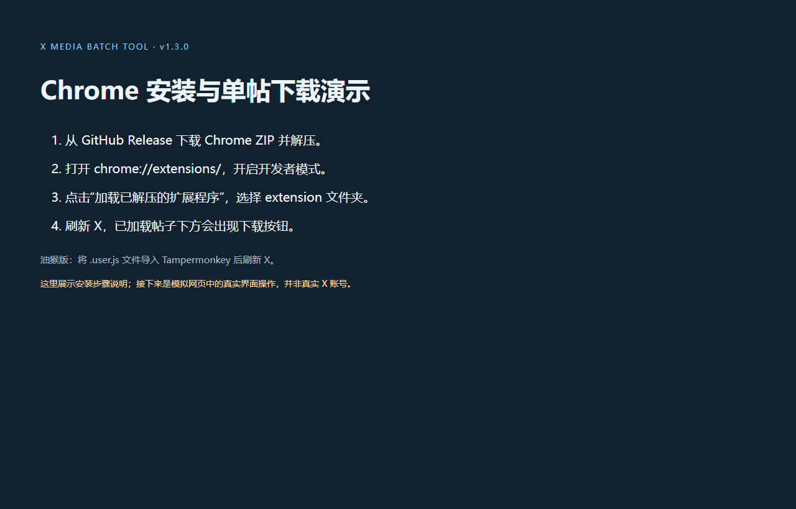
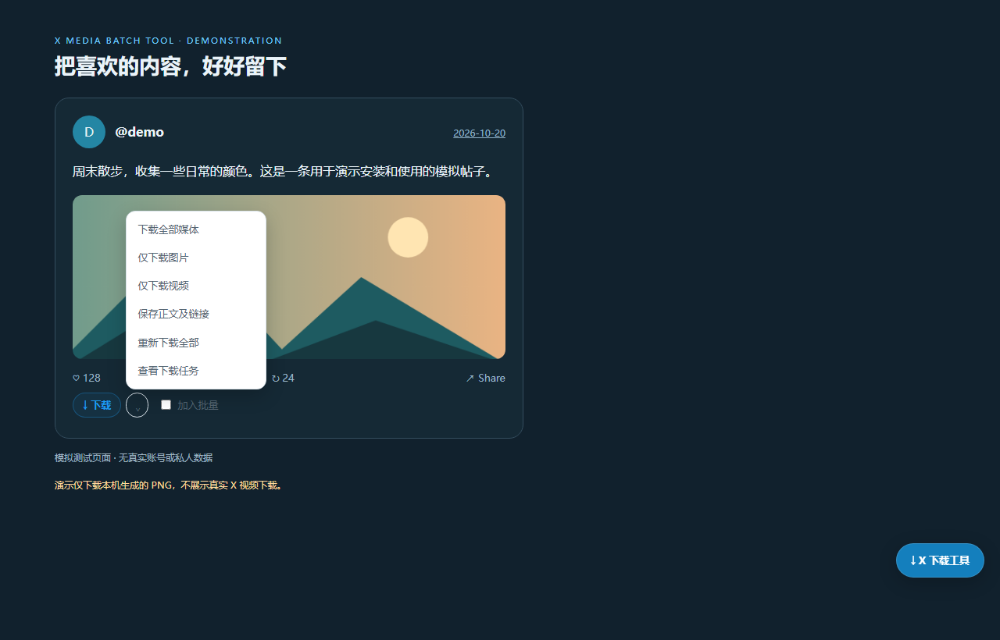

# 推特/X 下载工具：Chrome 扩展与油猴安装教程

[English](INSTALL.en.md) · [项目介绍](../README.zh-CN.md) · [常见问题](FAQ.zh-CN.md)

适用于 **v1.3.0**。Chrome 扩展与油猴版提供相同核心功能，选择一种启用即可。

## Chrome 扩展：四步安装

1. 打开 [GitHub Releases](https://github.com/AmBiTTion/x-media-batch-tool/releases/latest)，下载 `x-media-batch-tool-chrome-v1.3.0.zip`，解压到固定目录。GitHub 源码 ZIP 也包含可加载的扩展。
2. 电脑 Chrome 地址栏输入 `chrome://extensions/`，开启“开发者模式”。
3. 点击“加载已解压的扩展程序”，选择**包含 `manifest.json` 的 `extension` 文件夹**。不要选择 ZIP 或项目父目录。中文扩展名称为 **X Media Batch Tool｜推特/X 图片视频批量下载工具**。
4. 刷新 X 网页。帖子下方会显示 **↓ 下载**和**加入批量**，右下角 **↓ X 下载工具**可以展开面板。

本版未上架 Chrome 应用商店；扩展声明桌面 Chrome 111+。安卓需要按具体浏览器与油猴版本验证，不因窄屏界面就认定可运行。

## 油猴脚本安装

1. 在支持的浏览器中安装 [Tampermonkey](https://www.tampermonkey.net/)。
2. 打开[原始 `.user.js` 文件](https://github.com/AmBiTTion/x-media-batch-tool/raw/refs/heads/main/userscript/x-batch-tool.user.js)，或导入 Release 中的脚本。必要时添加新脚本，用文件完整内容替换默认模板。
3. 保存并启用脚本，按要求允许访问 X、运行用户脚本和下载，再刷新 X。

## 第一次下载

1. 找到你有权保存的帖子，点击**下载**；或通过旁边菜单选择**仅下载图片 / 仅下载视频**。
2. 点击帖子旁的状态打开**下载任务**，查看完成结果或失败原因。
3. 到浏览器下载目录查看文件。想主动保存副本可选**重新下载全部**；希望附带正文，可开启**设置 → 下载媒体时同时保存正文**。
4. 批量时勾选**加入批量**，或进入**帖子列表 → 收集当前页面**，再点**下载选中**。滚动收集有轮数限制，仅覆盖实际加载内容。

## 语言和更新

**设置 → 界面语言**提供跟随浏览器、简体中文、English。英文界面对应 **Settings → Interface language**。切换立即生效，保留已选帖子和任务，刷新后仍记住设置。点击**知道了**关闭首次使用卡片。

扩展更新时覆盖原安装目录文件，在 `chrome://extensions/` 点击该扩展的重新加载按钮，再刷新 X。更换目录可能改变扩展身份和数据存储，请先导出。油猴更新时替换代码、保存并刷新。如果未来版本申请新增权限，请核对权限说明。

## 观看演示

[中文安装与使用演示（WebM）](https://github.com/AmBiTTion/x-media-batch-tool/releases/download/v1.3.0/x-media-batch-tool-zh-CN-v1.3.0.webm)

开头是实际安装步骤的说明页，不是录制 Chrome 扩展设置页；随后是在模拟网页上运行真实油猴界面，使用浏览器保存本机生成的风景 PNG，并核对下载字节。不代表已经验证真实 X 账号媒体下载或安卓兼容。
